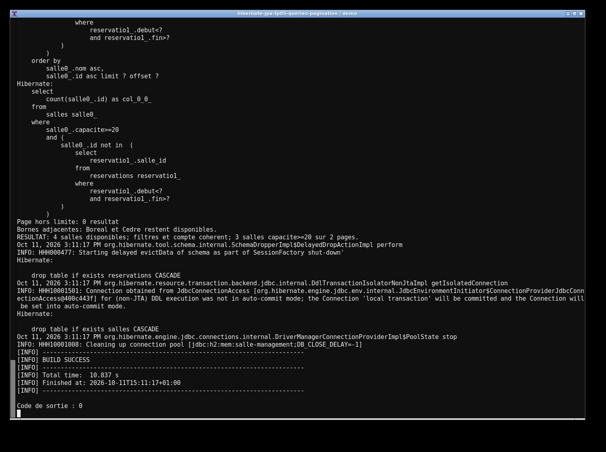
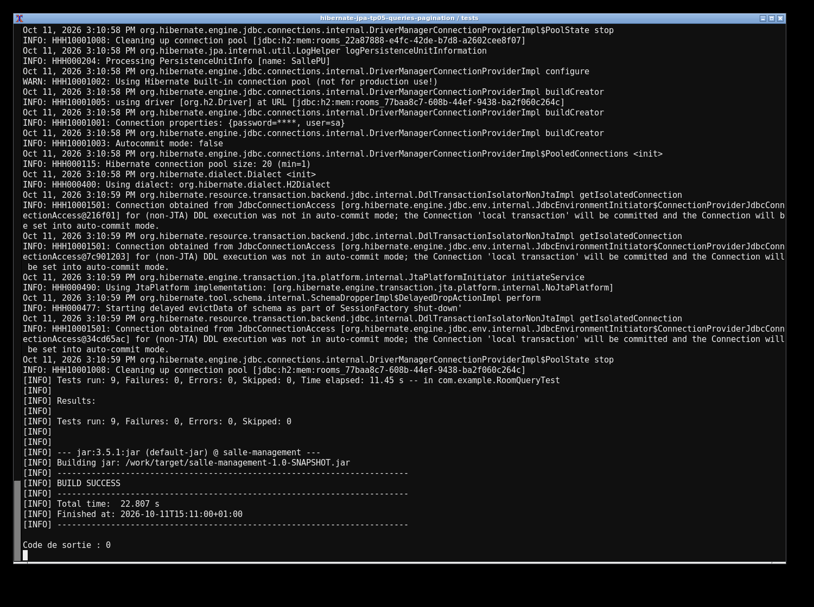

# TP 5 — Requêtes avancées, recherche multicritère et pagination

Dans ce TP, j'ai utilisé JPQL et Criteria pour chercher des salles disponibles. La recherche peut combiner le nom, la capacité minimale et un créneau de réservation. Les résultats sont paginés, avec un total calculé à partir des mêmes filtres.

Pour lancer le projet, il faut Java 17 et Maven. La base H2 est en mémoire.

```sh
mvn test
mvn exec:java
```

La démo contient 6 salles et 5 réservations. Le filtre sur le nom « e », une capacité minimale de 20 et la disponibilité retourne Boreal, Cedre et Falaise, réparties sur 2 pages. Les 9 tests passent.

Les captures de la démo et des tests viennent d’exécutions réelles dans le terminal. Les sorties d'exécution sont dans `evidence/`.




